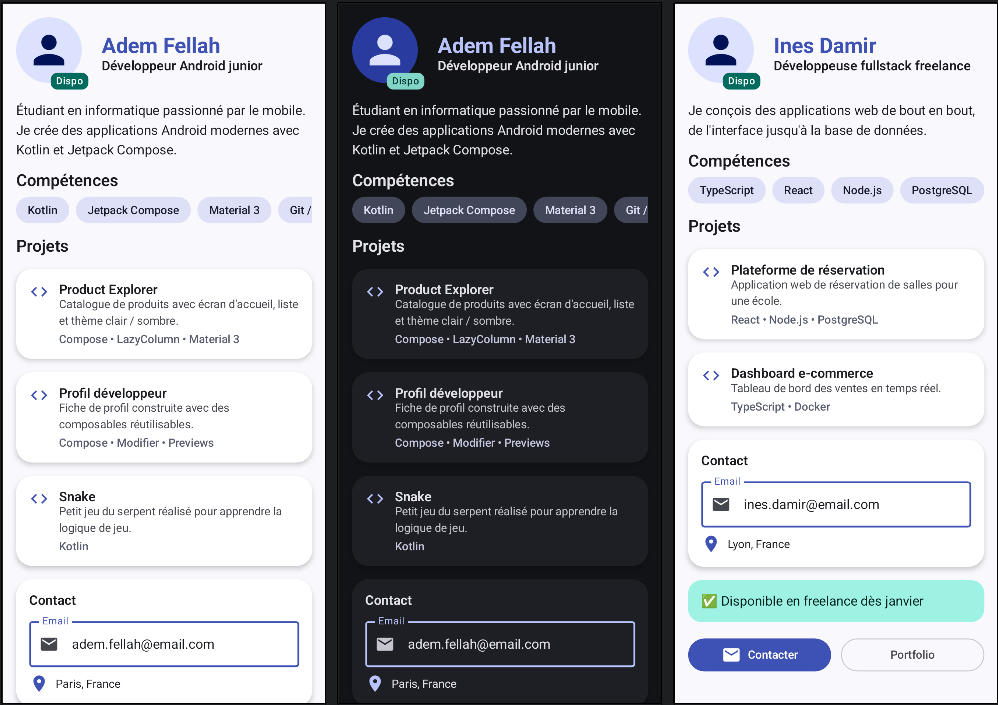

# Profil développeur – Amélioration UI (Compose UI & Material 3)

## Description

Cette application Android affiche le profil complet d'un développeur Android junior (Adem Fellah), réalisé avec Jetpack Compose.
L'écran présente un avatar avec un badge de disponibilité, le nom et le rôle, une description, une liste horizontale de compétences, une liste de projets, une carte de contact et deux actions (« Contacter » et « Portfolio »).
C'est une évolution de la première application « Profil développeur » : l'interface utilise maintenant les listes modernes (`LazyColumn` / `LazyRow`) et un thème Material Design 3 personnalisé, en clair comme en sombre.
Les données sont locales, écrites directement dans le code Kotlin. Les clics appellent des callbacks vides.

## Composants Compose utilisés

| Composant | Utilisation |
|---|---|
| `Text` | Nom, rôle, description, titres de section, contenus des cartes |
| `Button` / `OutlinedButton` | Actions « Contacter » (principale) et « Portfolio » (secondaire) |
| `Icon` | Icône « code » des projets, email, localisation, icône du bouton Contacter |
| `Image` | Avatar placeholder (`Icons.Default.Person` teinté avec la couleur du thème) |
| `Card` | `ProjectCard` (un projet) et `ContactCard` (coordonnées) |
| `OutlinedTextField` | Email en **lecture seule** (`readOnly = true`) dans la carte de contact |

## Layouts utilisés

| Layout | Utilisation |
|---|---|
| `Column` | Contenu vertical des cartes, identité (nom + rôle), section compétences |
| `Row` | En-tête (avatar à côté du nom), icône + texte dans `ProjectCard` et `InfoRow`, boutons côte à côte avec `weight(1f)` |
| `Box` | `ProfileAvatar` : le badge « Dispo » est **superposé** à l'avatar avec `Modifier.align(Alignment.BottomEnd)` |
| `Spacer` | Espaces contrôlés entre l'avatar et le texte, entre les icônes et les textes, entre les boutons |
| `Surface` | Avatar rond, badge, pastilles de compétences (`SkillChip`), bandeau de disponibilité cliquable |

## Listes : `LazyColumn` et `LazyRow`

- **`LazyColumn` (écran entier, `ProfileScreen`)** : tout l'écran est une liste verticale qui défile. Elle utilise `contentPadding` pour la marge autour du contenu et `Arrangement.spacedBy(16.dp)` pour l'espace entre les blocs.
  - Les sections uniques (en-tête, description, compétences, contact, disponibilité, boutons) sont ajoutées avec **`item { }`**.
  - Les projets sont ajoutés avec **`items(profile.projects, key = { it.id })`** : Compose appelle le composable réutilisable **`ProjectCard`** pour chaque projet. La `key` donne une identité stable à chaque élément.
- **`LazyRow` (`SkillRow`)** : les compétences défilent horizontalement. Chaque compétence est affichée par le composable réutilisable **`SkillChip`**.
- « Lazy » signifie que Compose ne compose que les éléments visibles à l'écran : c'est efficace même si la liste devient longue.

## Choix du thème (Material Design 3)

- **Couleurs (`ColorScheme`)** : une palette claire et une palette sombre définies dans `Theme.kt`, choisies automatiquement avec `isSystemInDarkTheme()`.
  - `primary` **bleu indigo** : identité « développeur », utilisé pour le nom, les icônes et le bouton principal ;
  - `tertiary` **vert sarcelle** : réservé à la **disponibilité** (badge « Dispo » et bandeau), pour la repérer immédiatement ;
  - `secondaryContainer` pour les pastilles de compétences, `surface` pour les cartes, `background` pour le fond.
  - Chaque couleur de fond a sa couleur de contenu `on…` (ex. `onTertiaryContainer`), ce qui garantit un texte lisible dans les deux thèmes.
  - Les couleurs dynamiques (Material You) sont désactivées pour garder la même identité visuelle sur tous les téléphones.
- **Typographie (`Type.kt`)** : hiérarchie claire — `headlineMedium` en gras pour le nom, `titleLarge` pour les titres de section, `titleMedium` pour les titres de cartes, `bodyLarge` / `bodyMedium` pour les textes, `labelLarge` pour les pastilles.
- **Formes (`Shapes`)** : arrondis cohérents — `small` (badge), `medium` (bandeau), `large` (cartes), `extraLarge` (pastilles de compétences en forme de pilule).
- **Aucune couleur n'est écrite en dur dans les écrans** : tout passe par `MaterialTheme.colorScheme`, `MaterialTheme.typography` et `MaterialTheme.shapes`.

## Previews

- `ProfileScreenLightPreview` : profil Android en thème clair ;
- `ProfileScreenDarkPreview` : profil Android en thème sombre ;
- `ProfileScreenFullstackPreview` : un second profil (développeuse fullstack) pour vérifier que les composables affichent d'autres données.

## Capture d'écran

## Quelles notions du chapitre Compose UI avez-vous réutilisées ?

J'ai réutilisé les **composants fondamentaux** (`Text`, `Button`, `Icon`, `Image`, `Card`, `OutlinedTextField` en lecture seule), les **layouts** (`Column`, `Row`, `Box` pour superposer un badge, `Spacer`, `Surface`), les **listes modernes** (`LazyColumn` avec `item` / `items` et `key`, `LazyRow`) avec des **cartes réutilisables** (`ProjectCard`, `SkillChip`), et **Material Design 3** (`ColorScheme`, `Typography`, `Shapes`, thème clair / sombre).
J'ai aussi gardé les bonnes pratiques du premier devoir : composables découpés et paramétrés, `modifier: Modifier = Modifier`, callbacks pour les actions, accessibilité (`contentDescription`, `Role.Button` sur la zone cliquable) et plusieurs previews.
